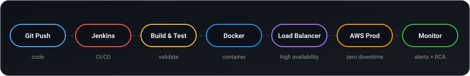

<!-- ===================== HEADER ===================== -->
<div align="center">


<a href="https://shanmugananthan.com">
  
</a>

<br/><br/>


<br/><br/>

[](https://shanmugananthan.com)
[](https://linkedin.com/in/shanmugananthan)
[](mailto:shanmugananthan.a.k@gmail.com)

</div>


## 👨‍💻 About Me


I'm a **Cloud Engineer** from **Chennai, India 🇮🇳** with **3.4 years** of hands-on experience in AWS infrastructure, Linux administration, CI/CD automation and production deployments.

I keep production systems **fast, secure and always on**, from Jenkins pipelines and Dockerized apps to WAF, DDoS protection, SSL/TLS and secrets management.

```yaml
name: Shanmugananthan A K
role: Cloud Engineer | DevOps Engineer
company: Kripya Solutions (Oct 2025 – Feb 2027)
location: Chennai, Tamil Nadu, India
superpowers:
  - AWS cloud architecture
  - CI/CD automation (Jenkins)
  - Monitoring and observability
  - Incident response and RCA
  - Security hardening
ask_me_about: [AWS, Linux, Jenkins, Docker, Ansible, Cloudflare]
```

- 🔭 **Cloud Engineer at Kripya Solutions** (Oct 2025 – Feb 2027)
- ⚡ **Zero-downtime releases** for web and mobile apps (Google Play and App Store)
- 🛡️ Security-focused: **WAF, DDoS protection, SSL/TLS, KMS, Secrets Manager**
- 📈 Monitoring with **Grafana, Loki, Nagios and Datadog**
- 🎓 **MCA**, Mepco Schlenk Engineering College
- 👯 Former freelance **IoT trainer**, I love teaching what I learn

---

## 💼 Work Experience

<table>
<tr>
<td width="50%" valign="top">

### ☁️ Cloud Engineer
**Kripya Solutions** · *Oct 2025 – Feb 2027*

- Deploy and manage **C8 applications** in high-availability production environments
- Deploy **Docker** containers and configure **load balancers** for even traffic distribution
- Monitor health with **Nagios, Grafana and Datadog**, resolving incidents proactively
- Perform **Root Cause Analysis** and implement preventive measures
- Automate client onboarding into monitoring using **Ansible playbooks**
- Run **zero-downtime rolling deployments** with pre-deployment validation
- Manage scheduled **backups** and **license renewals**

</td>
<td width="50%" valign="top">

### 🖥️ System Administrator
**Trioangle Technologies** · *Jun 2023 – Oct 2025*

- Deployed **PHP and Node.js** apps on **AWS, DigitalOcean, Contabo and cPanel**
- Designed AWS infra with **EC2, RDS, S3, CloudFront, Route 53, ACM**
- Built **Jenkins CI/CD** pipelines for build, test and deploy
- Implemented **Cloudflare CDN and DDoS protection**
- Secured systems with **WAF, KMS and Secrets Manager**
- Automated provisioning with **shell scripts**
- Administered **MySQL and MongoDB** (backups, tuning)
- Managed **Android and iOS** release pipelines
- Provided **on-call support** for critical incidents

</td>
</tr>
</table>

### 🗺️ Career Timeline

<div align="center">

</div>

---

## 🏆 Key Achievements

<div align="center">

| ☁️ Cloud Migration | 🚨 Incidents Resolved | 💰 AWS Cost Saved | 🤖 Automation |
|:---:|:---:|:---:|:---:|
| **On-Prem → AWS** | **200+** | **30%** | **Ansible** |
| Moved entire apps to AWS for better availability and scalability | Server-down issues restored to live | Removed unused cloud resources | Agent updates across all servers, no more manual work |

</div>

- 🔐 **Secure access:** exposed local servers safely using **Cloudflare Tunnel**, no public IP required
- 🛡️ **Security:** hardened production apps and infrastructure end to end

---

## 🛠️ Tech Stack

<div align="center">


<br/>


<br/><br/>


</div>

| 🧩 Area | 🔧 Tools |
|---|---|
| **☁️ Cloud** | AWS (EC2, EBS, RDS, S3, CloudFront, Route 53, ACM, ELB, WAF, KMS, Secrets Manager, Cognito), Azure (VMs, Static Web Apps), DigitalOcean, Contabo |
| **🔄 CI/CD & VCS** | Jenkins, Git, GitHub, Bitbucket |
| **📦 Containers, IaC & Automation** | Docker, Ansible, Terraform, Shell Scripting |
| **📈 Monitoring** | Grafana, Loki, Nagios, Datadog |
| **🛡️ Security** | Cloudflare (CDN, DNS, DDoS), AWS WAF, SSL/TLS (ACM), KMS, Secrets Manager, Cognito |
| **🖧 Servers & DBs** | Linux, Apache, cPanel, DNS, MySQL, MongoDB |
| **🚀 Deployment** | PHP apps, Node.js apps, Android (Google Play), iOS (App Store) |

### 🔁 How I Ship Code

<div align="center">

</div>

---

## 🌍 Open Source

I believe in giving back. I share scripts, automation and tools with the community.

<!-- Replace the repo names below with your real open source repositories -->
<div align="center">

<a href="https://github.com/iamshanmugananthan/REPO_NAME_1">
  
</a>
<a href="https://github.com/iamshanmugananthan/REPO_NAME_2">
  
</a>
<a href="https://github.com/iamshanmugananthan/REPO_NAME_3">
  
</a>
<a href="https://github.com/iamshanmugananthan/REPO_NAME_4">
  
</a>

</div>

**What I publish as open source:**
- 🐚 Shell scripts for server automation and provisioning
- 🤖 Ansible playbooks for monitoring onboarding and agent updates
- 🔧 Jenkins pipeline examples and CI/CD templates
- 📚 Guides and notes on AWS, Linux and Docker

> 💡 Contributions, issues and stars are always welcome. [Browse all my repositories →](https://github.com/iamshanmugananthan?tab=repositories)

---

## 📊 GitHub Stats

<div align="center">


<br/>


<br/>


<br/><br/>


</div>

### 🐍 Contribution Snake

<div align="center">
<!-- Needs the snake.yml workflow (included separately) to generate this image -->
<picture>
  <source media="(prefers-color-scheme: dark)" srcset="https://raw.githubusercontent.com/iamshanmugananthan/iamshanmugananthan/output/github-snake-dark.svg" />
  <source media="(prefers-color-scheme: light)" srcset="https://raw.githubusercontent.com/iamshanmugananthan/iamshanmugananthan/output/github-snake.svg" />
  
</picture>
</div>

---

## 🎓 Education

| 🎓 Degree | 🏫 College | 📅 Year | 📈 CGPA |
|---|---|---|---|
| **MCA** | Mepco Schlenk Engineering College, Sivakasi | 2022 | 7.9 / 10 |
| **BCA** | Mannar Thirumalai Naicker College, Madurai | 2019 | 6.1 / 10 |

## 🧠 Core Competencies

`Cloud Infrastructure` `CI/CD Automation` `Infrastructure as Code` `Containerization` `Incident Management & RCA` `Monitoring & Alerting` `Cloud Security` `Database Administration` `Production Support` `Release Management`

---

## 🌐 Let's Connect

<div align="center">

[](https://shanmugananthan.com)
[](https://linkedin.com/in/shanmugananthan)
[](https://youtube.com/@shanmugananthan)
[](https://instagram.com/iamshanmugananthan)
[](https://facebook.com/iamshanmugananthan)
[](https://codepen.io/iamshanmugananthan)
[](mailto:shanmugananthan.a.k@gmail.com)

<br/>

### ✍️ Dev Quote of the Moment


<br/>

**⭐ If you like my work, drop a star on my repos. Thanks for stopping by! ⭐**


</div>
